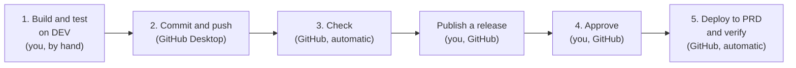
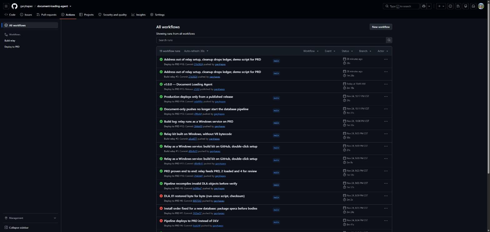
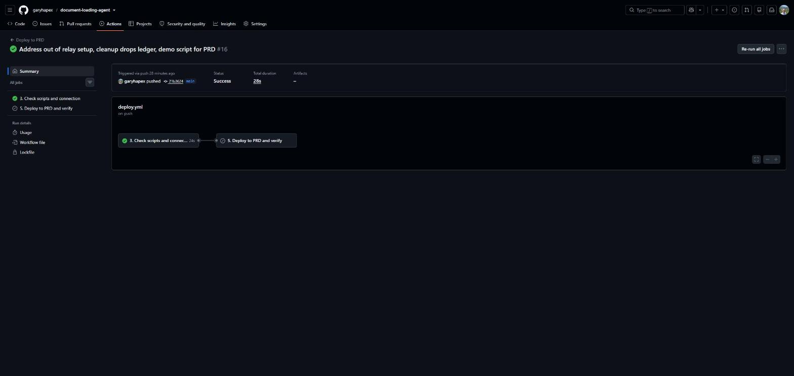
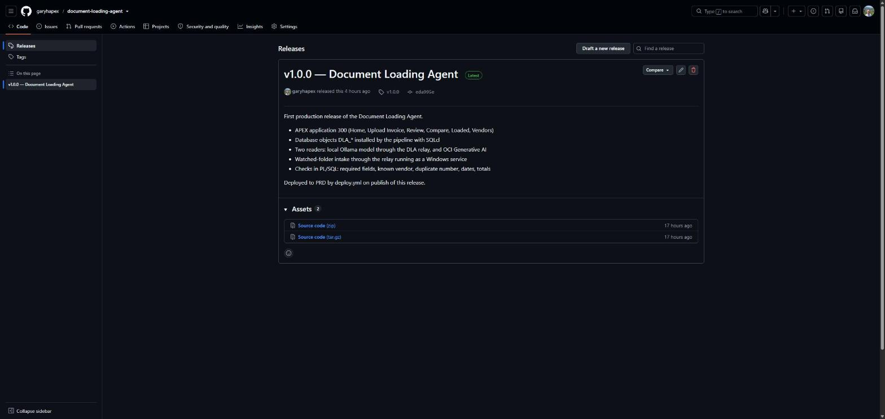
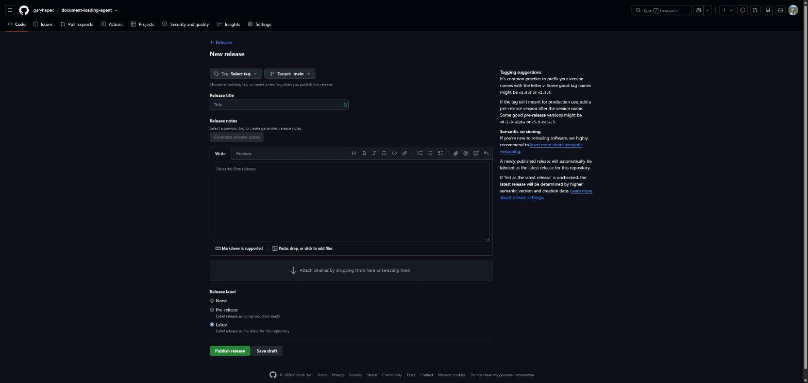
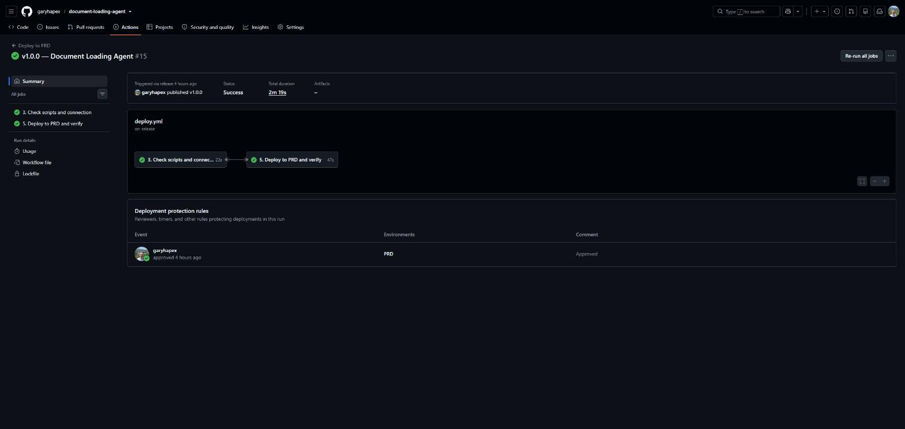
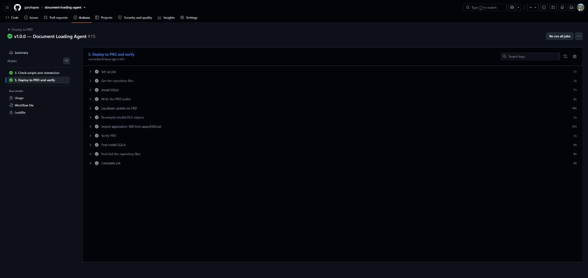
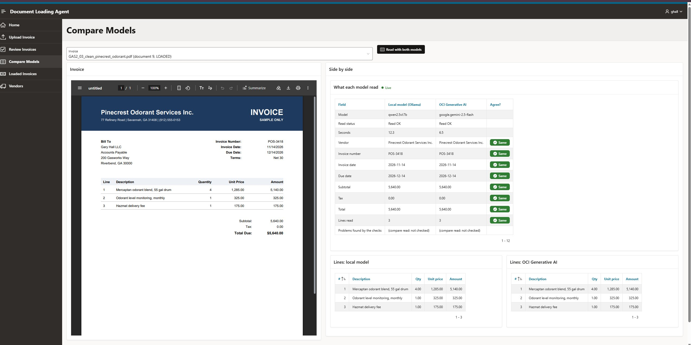
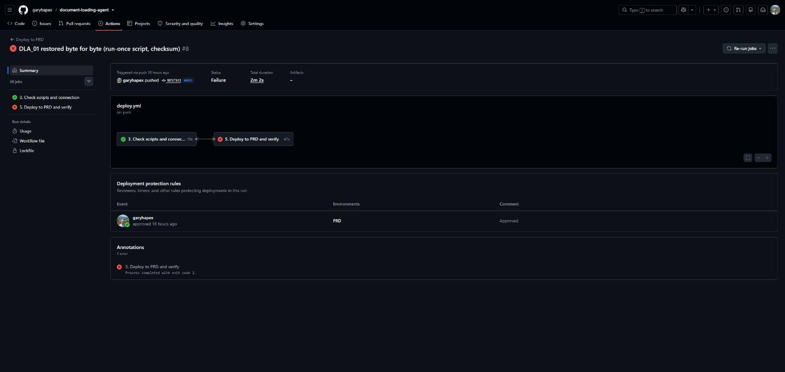
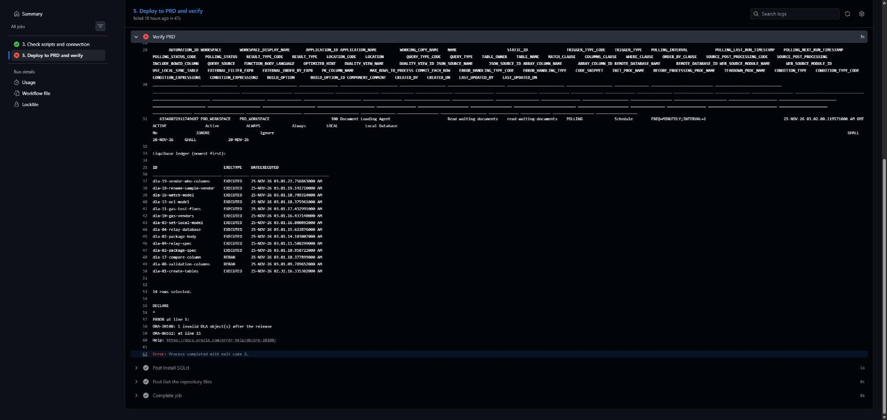

# CI/CD Pipeline Developer Guide

Document Loading Agent (DLA). Written by Claude for Gary D. Hall, 11/25/2026.

This guide is for the developer who **uses** the CI/CD pipeline every day: you build on DEV, put your change in the repository, and production is updated through a release you approve. How the pipeline itself was built is in `DLA_CICD_PIPELINE_SETUP_GUIDE.md`.

- **CI (continuous integration):** every push to `main` is checked automatically.
- **CD (continuous delivery):** a published release goes to production after a person approves it.

---

## 1. The picture



A push stops after step 3. Production is touched **only** when you publish a release and approve it.

---

## 2. Where things go in the repository

- `db/tables/`: create and alter table scripts
- `db/packages/`: package specs and bodies (`DLA_PKG`)
- `db/data/`: settings and seed data
- `db/relay/`: the database side of the relay
- `db/utilities/`: reset, re-read, inventory, drop-all. **Never deployed.**
- `db/deploy/changelog.xml`: **the list of scripts the pipeline installs, in order**
- `apex/f300.sql`: the export of APEX application 300
- `relay/`: the Node relay (built into a Windows installer by its own workflow, never deployed to the database)
- `docs/`, `README.md`, `CHANGELOG.md`, `samples/`: documents. Pushing only these starts nothing.

Every `.sql` file under `db/` must have a header block with the word `Script` in its first five lines. The check fails if one does not.

---

## 3. A database change

1. Write a **new** numbered script, for example `db/tables/DLA_21_ADD_PO_NUMBER.sql`, with the header block (Script, Purpose, Changes, Run as, Date).
2. Run it on **DEV** in SQL Developer (F5, Run Script) and test it.
3. Open `db/deploy/changelog.xml` and add one `changeSet` at the bottom, copied from the one above it, with a new `id` and your file name:

```xml
    <changeSet id="dla-21-add-po-number" author="garyhall" failOnError="true" runOnChange="true">
        <n0:runOracleScript objectName="DLA_21_ADD_PO_NUMBER" ownerName="WKSP_WKSPPRDWORKSPACE" sourceType="FILE">
            <n0:source><![CDATA[db/tables/DLA_21_ADD_PO_NUMBER.sql]]></n0:source>
        </n0:runOracleScript>
    </changeSet>
```

Two rules Liquibase enforces:

- **`runOnChange="true"`** means: if the file changes later, run it again on the next release. Use it for scripts that can safely run twice (packages with `CREATE OR REPLACE`, settings with `MERGE`, columns added only if missing).
- **A run-once script (no `runOnChange`) must never be edited after it has been deployed**, not even a comment. Liquibase keeps a checksum of the whole file and stops the deploy if it changed (run 7 on 11/24 failed on exactly this). Write a new script instead.

---

## 4. An APEX change

1. Change application 300 on **DEV** in App Builder and test it.
2. Export application 300 and save it over `apex\f300.sql` in the repository folder.

The pipeline imports `apex/f300.sql` into PRD on every release and switches the automation back on. Nothing else is needed.

---

## 5. Commit and push

In **GitHub Desktop**, repository `document-loading-agent`, Changes tab:

1. Type a **Summary** (one line: what changed).
2. Type a **Description** (why, and what was tested).
3. Click **Commit to main**.
4. Click **Push origin**.

What starts on GitHub depends on what the push changed:

- `db/`, `apex/`, `.github/workflows/deploy.yml`: **Deploy to PRD** runs, check job only.
- `relay/`: **Build relay** runs and builds a new relay installer.
- Only `docs/`, `README.md`, `CHANGELOG.md` or `samples/`: nothing runs.

---

## 6. Watch the check

GitHub, **Actions** tab. Every run is listed with a green tick or a red cross.



Click a run to see its jobs. After a push, `3. Check scripts and connection` is green and `5. Deploy to PRD and verify` is grey (skipped). That is correct: a push never deploys.



The check proves two things: every script has its header block, and SQLcl can sign in to PRD with the three secrets. It changes nothing.

---

## 7. Make a release

Do this when there is something on `main` you want in production.

1. Click **Code**, then **Releases** on the right, then **Draft a new release**.



2. Click **Tag: Select tag**. In the box **Search or create a new tag**, type the next version, for example `v1.0.1`.
3. At the bottom of that box, click **Create new tag**. In the window **Create new tag**, click **Create**.
4. **Release title:** the version and a few words, for example `v1.0.1 — PO number on invoices`.
5. **Describe this release:** what goes to production and why. This is what someone reads later to know what changed.
6. **Release label:** leave **Latest**.
7. Click **Publish release**.



Version numbers: last number for a fix (`v1.0.1`), middle number for something new (`v1.1.0`), first number for a big change (`v2.0.0`).

---

## 8. Approve the deploy

Publishing starts a new run on the **Actions** tab, named after the release title.

1. Open that run. When the check is green, the run waits and shows **Review deployments**.
2. Click **Review deployments**.
3. Tick **PRD**.
4. Click **Approve and deploy**.

The run then shows who approved it and when:



In a company, the approver is a different person from the one who released (GitHub's "Prevent self-review" setting). Here the developer and the approver are the same person.

---

## 9. Confirm on PRD

Click `5. Deploy to PRD and verify`. Every step is green:



- **Liquibase update on PRD:** runs the scripts in `changelog.xml` that PRD does not have yet, and re-runs changed `runOnChange` scripts.
- **Recompile invalid DLA objects:** a table change can leave packages invalid; this fixes them.
- **Import application 300 from apex/f300.sql:** the APEX application.
- **Verify PRD:** fails the run if any DLA object is invalid, the application or automation is missing, or the Liquibase ledger is short.

Then open the application on PRD and look at what you changed:



---

## 10. When a run fails

A failed run has a red cross. The summary shows which job failed:



1. Click the failed job.
2. The failed step is open with a red cross. Scroll to its **last lines**: the Oracle error is there.



Here (run 8, 11/24) the error is `ORA-20100: 1 invalid DLA object(s) after the release`: a table change left `DLA_PKG` invalid. The fix was the **Recompile** step, added to the pipeline in the next commit.

3. Fix it the same way every time: change the script on **DEV**, test it, commit, push, then publish a new release (for example `v1.0.2`) and approve it. Never fix PRD by hand; the next deploy would not know about it.

The three real failures from 11/24, for reference:

- **Run 6:** a package body could not compile because the package it calls did not exist yet. Fix: install both package specs before either body (order in `changelog.xml`).
- **Run 7:** Liquibase stopped because the run-once script `DLA_01_CREATE_TABLES.sql` had been edited. Fix: put the file back exactly as it was deployed.
- **Run 8:** verify found an invalid package after a table change. Fix: the Recompile step.

If the **check** job fails instead: either a script under `db/` is missing its header block (the log lists it as `MISSING`), or the sign-in to PRD failed (one of the three secrets is wrong or the wallet has expired).

---

## 11. Rolling back

A release that breaks production is undone with **another release**, never by hand on PRD.

1. In **GitHub Desktop**, open **History**, right-click the commit that caused the problem, and choose **Revert changes in commit**. This adds a new commit that undoes it.
2. Push, then publish a new release (for example `v1.0.3`) and approve it.

What that undoes:

- **The APEX application:** fully. The release imports `apex/f300.sql` as it was before.
- **A `runOnChange` script** (packages, settings): fully. The file changed back, so Liquibase runs the old version again.
- **A run-once script** (a new table or column): **not undone.** Liquibase does not drop what it created. Write a new numbered script that removes it, add it to `changelog.xml`, and release that.
