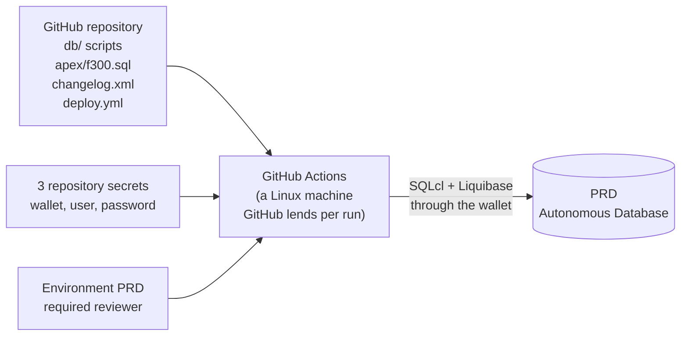
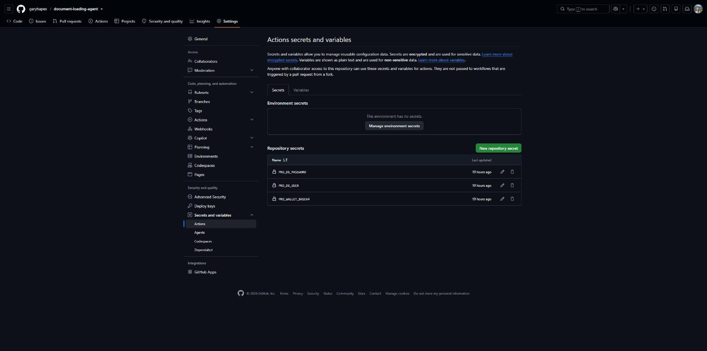
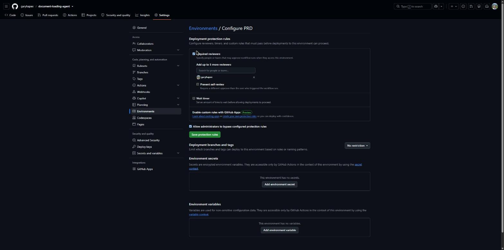
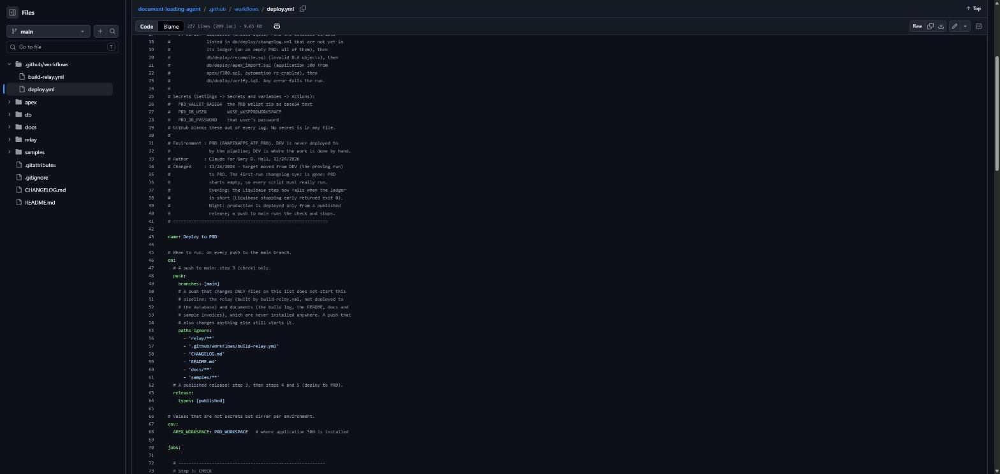

# CI/CD Pipeline Setup Guide

Document Loading Agent (DLA). Written by Claude for Gary D. Hall, 11/25/2026.

This guide explains how the CI/CD pipeline for this repository was **built**, so it can be built again for another project. How to **use** it every day is in `DLA_CICD_PIPELINE_DEVELOPER_GUIDE.md`.

---

## 1. The picture



The pieces, and where each one lives:

- **The workflow file** `.github/workflows/deploy.yml`: the instructions GitHub follows.
- **The Liquibase list** `db/deploy/changelog.xml`: which scripts to install, in order.
- **Three secrets** in the repository settings: how GitHub signs in to PRD. Never in a file.
- **The environment `PRD`** in the repository settings: the approval rule.
- **Three helper scripts** in `db/deploy/`: `recompile.sql`, `apex_import.sql`, `verify.sql`.

---

## 2. Check the target database first

Before pointing the pipeline at a database, find out what is already there. `db/utilities/DLA_20_PRD_CHECK.sql` is read-only (SELECT statements only). Run it in SQL Developer on the target database as the workspace schema user, F5.

It shows:

1. which user and database it is running as (proves it is the right one, and gives the user name for the secret),
2. the APEX version (must be at least the version `apex/f300.sql` was exported from),
3. the workspace name (needed by `apex_import.sql`),
4. any DLA objects already there (on 11/24 PRD had none),
5. any Liquibase ledger tables already there (expected: none),
6. that the label platform package the OCI settings script reads (`PKG_IMAGINARY_SPEC_READ`) exists and is VALID,

plus ORDS, the OCI web credential and the application ids already in use (300 must be free).

---

## 3. The wallet and the three secrets

GitHub signs in to the Autonomous Database the same way SQL Developer does: with the database's **wallet** (a zip file), a user and a password.

A secret can only hold text, so the wallet zip is stored as **base64 text** and turned back into the zip at the start of every run (`base64 -d` in `deploy.yml`).

**Turn the wallet into base64 text** (the build log does not record how this was done on 11/24; this is the standard way). In **Windows PowerShell**, paste this line with right-click and press Enter. Swap the file name for your wallet's real name in `C:\wallets`:

```
[Convert]::ToBase64String([IO.File]::ReadAllBytes("C:\wallets\Wallet_GHAPEXAPPS_ATP_PRD.zip")) | Set-Clipboard
```

The base64 text is now on the clipboard.

**Create the three secrets:** GitHub, repository **Settings** → **Secrets and variables** → **Actions** → **New repository secret**, once for each:

- `PRD_WALLET_BASE64`: paste the clipboard
- `PRD_DB_USER`: `WKSP_WKSPPRDWORKSPACE`
- `PRD_DB_PASSWORD`: that user's password



GitHub never shows a secret again after it is saved, and blanks it out of every run log. When the wallet is downloaded again (it expires), repeat this and update `PRD_WALLET_BASE64` with the pencil icon.

---

## 4. The PRD environment (the approval rule)

An **environment** is a named target with rules. The deploy job says `environment: PRD`, so GitHub applies PRD's rules before that job may start.

GitHub, repository **Settings** → **Environments** → **New environment**, name `PRD`, then:

- tick **Required reviewers** and add yourself,
- leave **Prevent self-review** off (one person both releases and approves; in a company it is ticked, so the approver must be someone else),
- click **Save protection rules**.



Required reviewers on a free plan work only on a **public** repository; that is one reason this repository was made public on 11/23.

---

## 5. The Liquibase list (`db/deploy/changelog.xml`)

Liquibase is built into SQLcl. It reads a list of scripts and keeps a **ledger** in the target schema of which ones it has already run, so each deploy runs only what is new.

Each script is one `changeSet`:

```xml
    <changeSet id="dla-02-package-spec" author="garyhall" failOnError="true" runOnChange="true">
        <n0:runOracleScript objectName="DLA_02_PACKAGE_SPEC" ownerName="WKSP_WKSPPRDWORKSPACE" sourceType="FILE">
            <n0:source><![CDATA[db/packages/DLA_02_PACKAGE_SPEC.sql]]></n0:source>
        </n0:runOracleScript>
    </changeSet>
```

- **`id`**: unique and never changed. The ledger remembers it.
- **`runOracleScript`, `sourceType="FILE"`**: SQLcl runs the file itself, so `SET`, `PROMPT`, `SHOW ERRORS` and `@` work as they do in SQL Developer.
- **`failOnError="true"`**: an error stops the deploy.
- **`runOnChange="true"`**: if the file changes, run it again next time. Only for scripts that are safe to run twice.
- **No `runOnChange`** (`DLA_01_CREATE_TABLES.sql`): run once, ever. Liquibase stores a checksum of the whole file; editing it afterwards stops every later deploy.

**Order matters.** The list is the install order on an empty database: tables, then both package specs, then both package bodies (the two packages call each other), then data and settings.

**Not on the list:** utilities (reset, drop-all, re-read, inventory) and read-only checks. They are never deployed.

**The ledger** is three tables Liquibase creates in the schema on the first deploy: `DATABASECHANGELOG` (one row per script run), `DATABASECHANGELOGLOCK` and `DATABASECHANGELOG_ACTIONS`. `db/utilities/DLA_99_DROP_ALL.sql` drops them too, so a clean start really starts clean.

---

## 6. The workflow file (`.github/workflows/deploy.yml`)



**When it runs (`on:`)**

- `push` to `main`: runs the check job only.
- `paths-ignore`: a push that changes only the relay, the relay workflow, `CHANGELOG.md`, `README.md`, `docs/` or `samples/` starts nothing, because none of them is installed in the database.
- `release: types: [published]`: a published release runs the check job and then the deploy job.

**`env: APEX_WORKSPACE: PRD_WORKSPACE`**: the one value that differs per database and is not secret. It is passed to `apex_import.sql` and `verify.sql`.

**Job `check` ("3. Check scripts and connection")**, on `ubuntu-latest`:

1. Get the repository files (`actions/checkout`).
2. Every `.sql` under `db/` has `Script` in its first five lines.
3. Install SQLcl (`gvenzl/setup-oracle-sqlcl`).
4. Write the wallet: `PRD_WALLET_BASE64` decoded back into `wallet.zip`.
5. Sign in to PRD and run one harmless query. The connection alias is read from the wallet's `tnsnames.ora` (the one ending in `_low`).

**Job `deploy` ("5. Deploy to PRD and verify")**:

- `needs: check`: only after the check passed.
- `if: github.event_name == 'release'`: only for a release. A push shows this job as skipped.
- `environment: PRD`: GitHub pauses here for the required reviewer.

Then, in order:

1. **Liquibase update on PRD**: `lb update -changelog-file db/deploy/changelog.xml`, then the ledger row count must equal the number of changeSets. Liquibase stopping early does not fail by itself (run 6 proved it), so this count makes it fail.
2. **Recompile invalid DLA objects** (`db/deploy/recompile.sql`): a table change marks packages invalid (run 8).
3. **Import application 300** (`db/deploy/apex_import.sql`): sets the workspace and application id 300, runs `apex/f300.sql`, then switches the automation "Read waiting documents" back on, because APEX disables automations on import.
4. **Verify PRD** (`db/deploy/verify.sql`): fails the run if any DLA object is invalid, application 300 or its automation is missing or inactive, or the ledger is short.

---

## 7. The relay build workflow (`.github/workflows/build-relay.yml`)

A second, separate workflow. It runs on a push that changes `relay/` (or by hand from **Actions** → **Build relay** → **Run workflow**), on GitHub's **Windows** machine, and builds the relay install kit: `DLA-Relay.exe` (the relay with Node inside), the WinSW service wrapper (checked by its SHA-256), and the setup files. The kit is a download on the run's page under **Artifacts**. It needs no secret, no approval and no database.

It runs on Windows because the kit runs on Windows: run 1 was built on Linux and the program would not start on Windows.

---

## 8. How it was built, and what the first deploys taught

**11/24, on DEV first (runs 1 to 5).** The pipeline was proven against DEV, where everything already existed. Liquibase's `changelog-sync` recorded the existing scripts as already run, so nothing was reinstalled. This proved the sign-in, the approval, the APEX import and verify.

**11/24 evening, pointed at an empty PRD (runs 6 to 9).** `DLA_20_PRD_CHECK.sql` first, then the PRD secrets and environment, then `deploy.yml` changed to PRD. An empty database is the real test: every script must install by itself.

- **Run 6 failed:** a package body ran a test that called the other package, which did not exist yet. Fix: both specs before either body.
- **Run 7 failed:** the run-once `DLA_01` had been edited (a header line), so its checksum no longer matched. Fix: put it back byte for byte.
- **Run 8 failed:** all scripts ran, but a later table change left `DLA_PKG` invalid. Fix: the recompile step.
- **Run 9 passed** in 45 seconds.

**11/24 night.** Every push was asking for approval to deploy to production, even with nothing to deploy. Changed so a push only checks, and only a published release deploys.

**11/25.** First release `v1.0.0` deployed to PRD (run 15). DEV secrets and the DEV environment removed.

---

## Doing it again for another project

1. Organize the repository: `db/` scripts with header blocks, `apex/` export, `db/deploy/`.
2. Run a read-only check like `DLA_20_PRD_CHECK.sql` on the target database.
3. Wallet to base64; create the three secrets.
4. Create the environment with a required reviewer.
5. Write `changelog.xml` in install order; mark only re-runnable scripts `runOnChange`.
6. Copy `deploy.yml` and the three `db/deploy/` scripts; change the application id, workspace, schema and secret names.
7. Push and watch the check go green.
8. Publish a first release, approve it, and read every failure to its last line until it is green.
